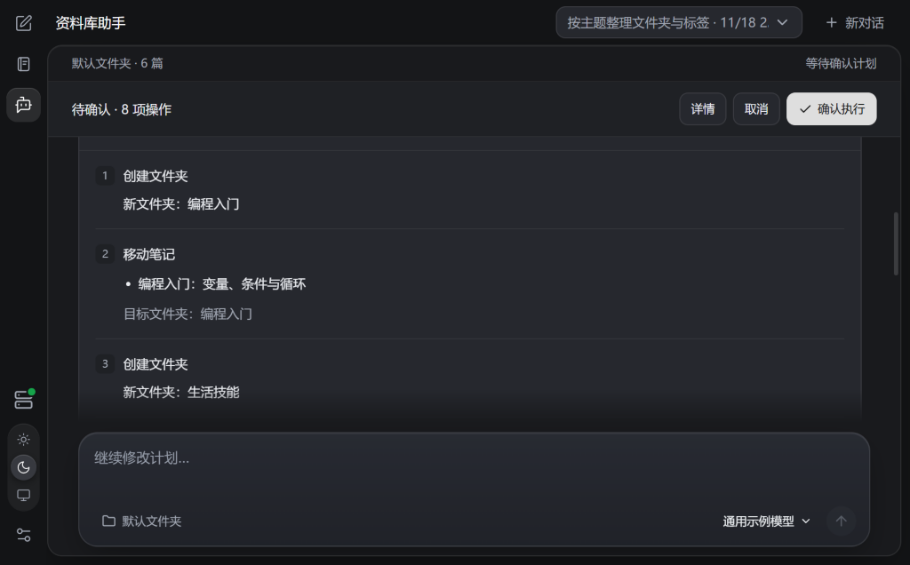

# BiliNote Studio

把视频教程与课程合集变成**可阅读、可回看、可自测、可追问、可整理、可外带**的结构化学习笔记。

BiliNote Studio 是基于 [JefferyHcool/BiliNote](https://github.com/JefferyHcool/BiliNote) v2.4.5 独立维护的非官方二次开发桌面版。在保留视频转写、AI 总结、截图、思维导图与导出链路的基础上，全面聚焦**高信噪比结构化阅读、单实体悬浮音视频回看、后台无感蒸馏队列、主动回忆自测复习、课程级批量生产与计划式资料库整理**。

> **版本状态（当前源码 `v0.4.1`｜最新公开安装包 `v0.4.0`）**：源码已定版 `0.4.1`（静态配图视觉分块与失败/顶栏状态机修复，详见 [0.4.1 发布说明](docs/releases/0.4.1.md) 与 [CHANGELOG.md](CHANGELOG.md)）；最新公开 Windows x64 安装包见 [GitHub Releases (`v0.4.0`)](https://github.com/hc568871650-commits/BiliNote-Studio/releases/tag/v0.4.0)，详见 [0.4.0 发布说明](docs/releases/0.4.0.md) 与 [0.4.0 验收记录](docs/releases/0.4.0-validation.md)。

https://github.com/user-attachments/assets/6b312937-4a66-4b2c-b808-c16d896c64bf

> `v0.4.0` 完整功能演示（73 秒 · 有声），上方点击即可原地播放；如需本地留存可获取 [离线原画下载（1080p@60fps）](https://github.com/hc568871650-commits/BiliNote-Studio/releases/download/v0.4.0/BiliNote-Studio-0.4.0-Launch-Demo.mp4) 或查看 [0.4.0 演示说明](doc/showcase/studio-0.4.0/README.md)。首屏演示来自 `0.4.0` 独立隔离环境基于公开技术资料录制，下方功能配图来自 `0.3.0` 与 `0.2.0` 隔离交互预览（`ui-preview.html`），均不含私人笔记、Cookie 或真实服务商凭据，来源见 [0.3.0 配图说明](doc/showcase/studio-0.3.0/README.md) 与 [0.2.0 配图说明](doc/showcase/studio-0.2.0/README.md)。

---

## 0.3.0 核心亮点

- **单实体卷帘悬浮音视频播放器**：将音频与视频回看统一为单一悬浮实体——默认收起为 `248×36px` 影院黑玻璃迷你音频条与无缝一体凹弧顶耳，支持实时字幕与贴顶自动下翻；按住顶耳上拉实时卷展为 16:9 视频（拉满无缝转全向自由拖框），触底继续下拉一比一压扁回音频条且音频不断；支持近边高阻尼防越界墙、四角 16:9 等比缩放、时间点点击直达、原文参照三向联动及 B 站 / YouTube 嵌入回看。
- **极速冷启动与前端首屏瘦身**：后端 `create_app` 冷启动压缩至约 `1.0s`（9 项重型依赖延迟加载，0 预载）；前端重组件按需拆包，首屏直载 JS 压在 `1350 KB` 预算内；Tauri 桌面端采用异步 FFmpeg 检测，100% 兼容既有 `bili_note.db`、`records-v2` 存储与 Windows DPAPI 密钥。
- **后台蒸馏队列 SSE 与无感导轨通知**：新增 `backend/app/jobs/` 任务总线与 `/api/jobs/events` 实时 SSE 推送；左侧导轨配备动态镂空遮罩「新建笔记」图标与强调色数字球（仅新建笔记页悬停展开队列预览，阅读页悬停静默防打扰），支持全部完成 / 逐条完成 / 静默三档提醒。
- **课程级批量导入、字幕直出与批量结构化升级**：
  - 支持多 P 合集 / 播放列表懒加载解析、去重标记、自动建同名文件夹与费用确认后批量入队；
  - 支持拖入本地 `.srt / .vtt` 字幕文件（UTF-8 / BOM / GBK），自动跳过下载与语音转写直接生成结构化笔记；
  - 笔记库支持多选旧版 Markdown 笔记，经原生 `<dialog>` 费用确认后批量升级为结构化视图并保留历史版本。
- **沉浸复习闭环、现代思维导图与 4 格式外带**：跨笔记「错题与高频避坑」复习本支持整卡点击展开原位重练、翻卡自检、掌握状态流转（`ever_wrong / mastered`）及跨路由 `1.6s` 脉冲锚点直达；内置结构化现代思维导图；导出新增 **Obsidian 增强 Markdown**（含 YAML Frontmatter 与 Callout）与 **Anki `.tsv` 闪卡**。

---

## 功能一览

| 使用场景 | 核心能力 |
| --- | --- |
| **高信噪比结构化阅读** | 结论高亮、下划线、动态强调色波浪线、防挤压对比表、因果链、句末柔光毛玻璃详注、结构化现代思维导图 |
| **单实体悬浮原声/视频回看** | `248×36px` 影院黑迷你音频条、一体顶耳上拉卷展 16:9 视频、触底续拉压扁收起、贴顶字幕下翻、原文参照三向联动 |
| **主动回忆与复习闭环** | 原位膨胀自测胶囊、三级判题解析、核对清单、跨笔记错题/避坑复习本原位重练、翻卡自检、掌握流转与脉冲锚点直达 |
| **多源与课程级批量生产** | 远程平台/本地视频、多 P 合集勾选批量入队、本地 `.srt/.vtt` 字幕免转写直出、旧笔记批量结构化升级、局部重蒸馏与两方案对照 |
| **无感后台队列与知识外带** | SSE 实时任务队列、导轨动态新建图标与强调色数字球、三档完成提醒、Markdown / Obsidian / Anki `.tsv` / 纯文本 4 格式导出 |
| **围绕原文精准追问** | 阅读与助手并排分栏、划词/段落多选引用、自测题一键打包追问、图片/文本附件、流式回复与中断恢复 |
| **资料库检索与安全整理** | 全库正文/转录检索与来源定位；先审阅整理计划、确认后执行、支持冲突检查式撤销，无永久删除正文权限 |
| **分用途模型与本机安全** | 生成/阅读/整理独立默认模型、多协议能力检测、按需联网检索、用量与费用透明明细、Windows DPAPI 密钥加密 |

---

## 结构化阅读与主动自测

主阅读画布采用渐进披露设计：默认仅呈现精干结论、防挤压参数对比表与单行因果链；底层原理、原片案例与避坑提示收敛在句末柔光锚点中，悬停预览、点击展开半透明毛玻璃详注卡片，对下方正文零排版挤压。

章节末尾提供实战自测胶囊与核对清单。作答后即时呈现三级判题层次与参考解析，点击「去问助手」即可将题干、误选项、解析与章节背景打包注入右侧助手深入追问；错题与高频避坑自动汇总至复习本，支持整卡原位重练与跨路由锚点直达。


---

## 阅读助手并排讨论

阅读助手与正文并排展示，支持自由拖拽分栏宽度、切换全屏或一键收起。划词选段、段落块多选或自测题追问均保留原文来源与版本快照。


- 一次选段中的多个段落合并为一份紧凑引用，单条消息最多携带 8 份引用或附件。
- 支持图片、TXT 与 Markdown 附件的选择、粘贴、拖入与预览；图片理解能力取决于所选模型。
- 默认流式回复，展示等待时间、回复用时与错误详情；异常中断后可恢复原草稿与附件。
- 长对话支持用量提示、自动压缩与 `/compact` 手动压缩，保留原始聊天记录。

---

## 资料库助手：先审阅计划，再安全整理

资料库助手可检索本地笔记正文、读取章节与原始转录，结合多篇笔记回答问题并给出可点击跳转的来源。需要调整资料结构时，遵循严格的人机确认闭环：

**提出需求 → 审阅具体计划 → 点击确认执行 → 查看结果或撤销**



- 可将整理范围限定为全部笔记、指定文件夹或选定笔记，目标不明确时先澄清。
- 支持创建/重命名逻辑文件夹、移动笔记归属、增删标签、归档与恢复；不具备永久删除笔记、改写正文或操作任意本地文件的权限。
- 撤销前自动检查后续变更，避免覆盖新产生的修改。

---

## 分用途模型配置与生成透明

在「设置 → 模型与 API」中可为**笔记生成、阅读问答、资料库助手**分别指定默认服务商与模型，也可在任意会话中临时切换。


- **多协议支持**：阅读与资料库助手支持 OpenAI Chat Completions、OpenAI Responses、Anthropic Messages 与 Gemini 协议；视频总结走 Chat Completions 兼容接口。
- **能力检测与按需联网**：支持基础回复、流式、工具调用、视觉、联网与思考档位检测；按需外部检索支持 Tavily 与 SearXNG。
- **生成详情透明化**：展示请求尝试、token 用量、耗时、参数快照与估算费用（服务商未返回的字段保持未知，费用估算不等同账单），并支持冻结同一来源进行两方案对照测试。
- **凭据本机保护**：Windows 平台下服务商 API 密钥默认经系统 DPAPI 加密落盘，不再以明文保存在配置数据库中。

---

## 开始使用

### 1. Windows 安装（推荐）

前往 [GitHub Releases (`v0.3.0`)](https://github.com/hc568871650-commits/BiliNote-Studio/releases/tag/v0.3.0) 下载单一 Windows x64 安装包 `BiliNote-Studio-0.3.0-windows-x64-setup.exe`（`74,612,531` 字节）及校验文件 `SHA256SUMS.txt`，核对 SHA-256（`f86a02d549d3e6290ab2390aa7f3dda72e59ea3e34cd408c0005f9c2c3ca95cc`）后运行安装。

- **独立身份与数据分离**：公开安装版应用标识 `com.bilinote.studio`，后端端口 `38484`，用户数据位于 `%LOCALAPPDATA%\BiliNoteStudio`，不覆盖原版 BiliNote，也不会自动导入旧数据库；Studio `0.2.0 → 0.3.0` 覆盖安装自动保留数据。
- **外部依赖说明**：首次使用视频生成功能需本机已安装 FFmpeg 并配置转写与大模型服务；仅阅读、管理资料或导入 `.srt/.vtt` 字幕不需要 FFmpeg。
- **公开包裁剪范围**：保留全部阅读/自测/整理与 4 格式导出功能；不内置 FFmpeg、PDF 导出（PyMuPDF）、本地 Whisper 或抖音链接下载。详细说明见 [用户指南](docs/studio/USER_GUIDE.md)。

### 2. 零配置体验 0.3.0 独立 UI 预览

已安装 Node.js 与 pnpm 时，可在仓库根目录直接体验 `0.3.0` 全部前端交互（含单实体卷帘悬浮播放器、多 P 合集导入、字幕直出提示、批量结构化升级确认弹窗、导轨数字球队列与复习本重练；使用独立端口与合成数据，不启动后端，零模型费用）：

```powershell
cd BillNote_frontend
pnpm install
pnpm dev:warm
```

启动后在浏览器访问 `http://127.0.0.1:21483/ui-preview.html`。

### 3. 从源码开发或构建 `0.3.0`

完整开发隔离规范与安装包构建参数请阅读 [源码同步与发行流程](RELEASING.md) 与 [DEVELOPMENT.md](DEVELOPMENT.md)。请务必隔离前后端端口、应用标识及数据/缓存目录，避免连接日常正式数据。

---

## 数据安全与当前边界

- **本地优先与外发透明**：笔记与学习状态均保存在本机；调用外部转写、大模型或联网检索时，仅按对应功能将必要正文、转录或检索词发送给所选服务商，模型不具备任意本地文件访问权限。
- **归档与删除分离**：归档笔记可随时阅读与恢复；永久删除仅支持针对归档笔记手动触发且限于其专属目录。
- **旧版边界**：Studio 采用独立安装目录与新存储结构（`records-v2`），不承诺与旧版原版 BiliNote 共享数据库或通用无损迁移；Studio 自身 `0.2.0 → 0.3.0` 保持 100% 存储与凭据兼容。
- **当前限制**：
  - 当前主要交付与实机验收围绕 Windows x64，尚未完成干净 Windows 虚拟机首次 WebView2 联网安装及跨平台验证。
  - 不同模型网关的协议与思考/联网参数存在差异，请以能力检测与实际测试为准。
  - 整理助手按单进程单 worker 设计，不建议多实例并发读写同一数据目录。

---

## 文档与上游致谢

- [0.3.0 发布说明](docs/releases/0.3.0.md) 与 [0.3.0 验收记录](docs/releases/0.3.0-validation.md)
- [变更记录（含 `0.3.0` 全量说明）](CHANGELOG.md)
- [0.3.0 隔离环境真实流程验收报告](docs/0.3.0-real-flow-validation-2026-11-20/VALIDATION_REPORT.md)
- [0.2.0 发布说明](docs/releases/0.2.0.md) 与 [0.2.0 验收记录](docs/releases/0.2.0-validation.md)
- [用户指南](docs/studio/USER_GUIDE.md)
- [源码同步与发行流程](RELEASING.md)
- [UI/UX 设计规范](docs/ui-design-guide.md)
- [第三方许可与来源](THIRD_PARTY_NOTICES.md)
- [上游项目 JefferyHcool/BiliNote](https://github.com/JefferyHcool/BiliNote)

## 许可证

本项目遵循 [MIT License](LICENSE)，保留 Jeffery Huang 的原始版权声明与上游许可证。感谢上游作者及所有贡献者。

BiliNote Studio 为独立维护的非官方二次开发版本；第三方依赖、大模型服务与视频素材分别遵循其各自许可证与服务条款。
