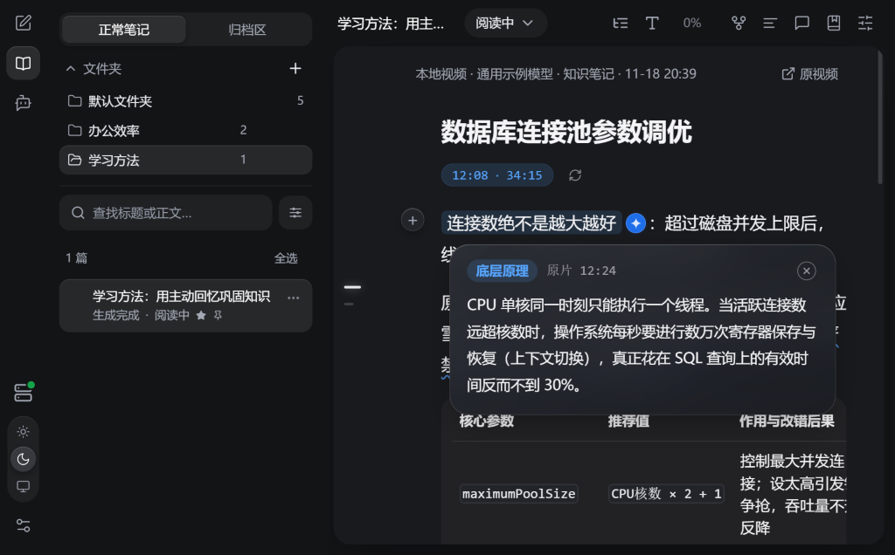
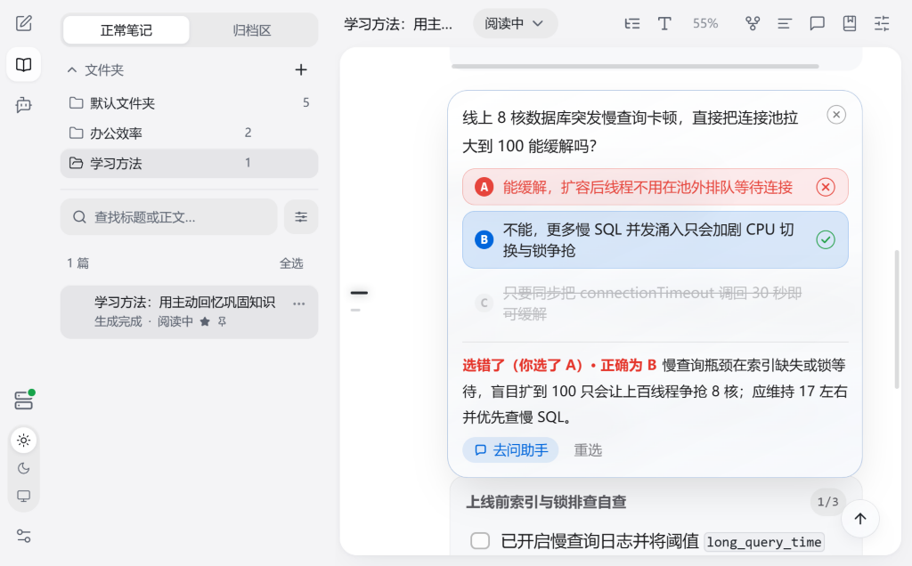
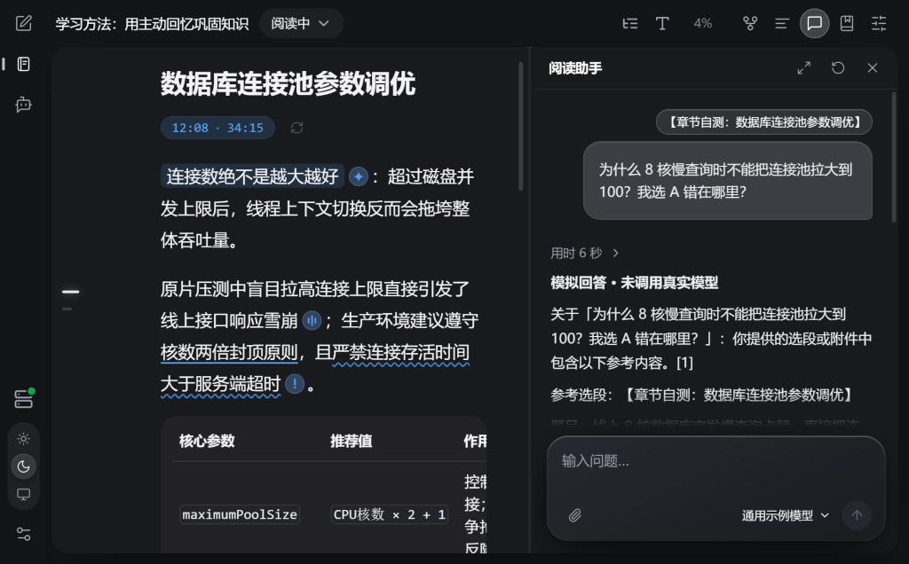
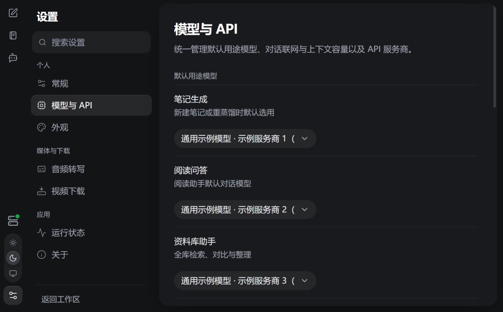

# BiliNote Studio

把视频教程变成**可阅读、可自测、可追问、可整理**的结构化学习笔记。

BiliNote Studio 是基于 [JefferyHcool/BiliNote](https://github.com/JefferyHcool/BiliNote) v2.4.5 独立维护的非官方二次开发桌面版。在保留视频转写、AI 总结、截图、思维导图与导出链路的基础上，将重点延伸到**高信噪比结构化阅读、主动回忆自测、上下文锚定追问与计划式资料库整理**。

> **版本状态（`v0.2.0`）**：Windows x64 安装版见 [GitHub Releases (`v0.2.0`)](https://github.com/hc568871650-commits/BiliNote-Studio/releases/tag/v0.2.0)。详细变更见 [0.2.0 发布说明](docs/releases/0.2.0.md)，实测范围与校验摘要见 [0.2.0 验收记录](docs/releases/0.2.0-validation.md)。



> 本页截图来自 `0.2.0` 隔离交互预览（`ui-preview.html`），使用合成示例笔记与模拟响应，不含私人教程或真实服务商凭据，来源见 [配图说明](doc/showcase/studio-0.2.0/README.md)。

---

## 0.2.0 核心亮点

- **结构化阅读器与高透毛玻璃批注**：支持将视频笔记输出或一键升级为结构化知识视图（核心结论高亮、下划线、波浪线、防挤压参数对比表、单行因果链），底层原理 / 实测案例 / 高频避坑细节折叠为句末柔光锚点，悬停预览、点击展开毛玻璃详注卡片且不打断正文排版。
- **原位膨胀章节自测与错题复习本**：章节末尾内置默认折叠的自测胶囊，点击原位展开并支持三级判题视觉层次（正解、误选、弱化干扰项）、解析展开与核对清单；作答状态持久化，可随时在「错题与高频避坑」回顾。
- **上下文锚定追问与并排阅读助手**：正文划词、段落选块与自测题「去问助手」均可一键将上下文（题干、误选项、解析、章节正文与原片时间戳）打包注入右侧阅读助手；支持多段引用、附件、流式回复与分栏宽窄自由拖拽。
- **三栏工作台与动效交互全面打磨**：动态开合笔记本侧栏图标、宽屏无晃动侧栏开关、按钮中心放射性明暗模式切换、8 组动态强调色、丝滑筛选与目录导航，兼顾长时间专注阅读体验。
- **分用途默认模型与 Windows DPAPI 凭据保护**：笔记生成、阅读问答、资料库助手可分别指定默认服务商与模型；支持多协议（OpenAI Chat Completions / Responses、Anthropic Messages、Gemini）与能力检测，Windows 下 API 密钥通过 DPAPI 本机加密保护。
- **可审阅的资料库助手与计划式整理**：按关键词检索全库正文与转录、附带原文来源定位；创建文件夹、移动归属、调整标签与归档均先生成可读计划，经人工确认后执行并支持冲突检查式撤销。

---

## 功能一览

| 使用场景 | 核心能力 |
| --- | --- |
| **高信噪比结构化阅读** | 结论高亮、防挤压对比表、因果链、句末柔光毛玻璃详注，支持旧 Markdown 笔记一键升级结构化 |
| **主动回忆与复习闭环** | 原位膨胀自测胶囊、三级判题解析、核对清单、阅读进度记录与跨笔记错题/避坑复习本 |
| **从视频到学习笔记** | 远程平台与本地视频导入、教程/知识双类型笔记、动态取帧、时间戳回看、局部重蒸馏与两方案对照 |
| **围绕原文精准追问** | 阅读与助手并排分栏、划词/段落多选引用、自测题一键追问、图片/文本附件与临时聊天 |
| **资料库检索与安全整理** | 全库正文检索与来源问答；先审阅整理计划、确认后执行、支持撤销，无永久删除正文权限 |
| **分用途模型与开销透明** | 生成/阅读/整理独立默认模型、能力检测、按需联网检索、用量/耗时/费用估算明细与上下文压缩 |
| **桌面阅读环境定制** | 深浅主题（放射性切换）、跟随系统、8 种动态强调色、字号与阅读宽度调节、专注模式与动态减弱 |

---

## 结构化阅读与主动自测

主阅读画布采用渐进披露设计：默认仅呈现精干结论、关键对比表与因果链；复杂原理、原片案例与避坑提示收敛在句末柔光锚点中，点击即展开半透明毛玻璃详注卡片，对下方正文零排版挤压。

章节末尾提供实战自测胶囊与核对清单。作答后即时呈现三级判题层次与解析，并可点击「去问助手」把当前题目、误选项与章节背景直接带入右侧对话框深入追问。已有 Markdown 笔记也支持保留原版的同时一键升级为结构化视图。



---

## 阅读助手并排讨论

阅读助手与正文并排展示，支持自由拖拽分栏宽度、切换全屏或一键收起。划词选段、段落块多选或自测题追问均保留原文来源与版本快照。



- 一次选段中的多个段落合并为一份紧凑引用，单条消息最多携带 8 份引用或附件。
- 支持图片、TXT 与 Markdown 附件的选择、粘贴、拖入与预览；图片理解能力取决于所选模型。
- 默认流式回复，展示等待时间、回复用时与错误详情；异常中断后可恢复原草稿与附件。
- 长对话支持用量提示、自动压缩与 `/compact` 手动压缩，保留原始聊天记录。

---

## 资料库助手：先审阅计划，再安全整理

资料库助手可检索本地笔记正文、读取章节与原始转录，结合多篇笔记回答问题并给出可点击跳转的来源。需要调整资料结构时，遵循严格的人机确认闭环：

**提出需求 → 审阅具体计划 → 点击确认执行 → 查看结果或撤销**


- 可将整理范围限定为全部笔记、指定文件夹或选定笔记，目标不明确时先澄清。
- 支持创建/重命名逻辑文件夹、移动笔记归属、增删标签、归档与恢复；不具备永久删除笔记、改写正文或操作任意本地文件的权限。
- 撤销前自动检查后续变更，避免覆盖新产生的修改。

---

## 分用途模型配置与生成透明

在「设置 → 模型与 API」中可为**笔记生成、阅读问答、资料库助手**分别指定默认服务商与模型，也可在任意会话中临时切换。



- **多协议支持**：阅读与资料库助手支持 OpenAI Chat Completions、OpenAI Responses、Anthropic Messages 与 Gemini 协议；视频总结走 Chat Completions 兼容接口。
- **能力检测与按需联网**：支持基础回复、流式、工具调用、视觉、联网与思考档位检测；按需外部检索支持 Tavily 与 SearXNG。
- **生成详情透明化**：展示请求尝试、token 用量、耗时、参数快照与估算费用（服务商未返回的字段保持未知，费用估算不等同账单），并支持冻结同一来源进行两方案对照测试。
- **凭据本机保护**：Windows 平台下服务商 API 密钥默认经系统 DPAPI 加密落盘，不再以明文保存在配置数据库中。

---

## 开始使用

### 1. Windows 安装（推荐）

前往 [GitHub Releases (`v0.2.0`)](https://github.com/hc568871650-commits/BiliNote-Studio/releases/tag/v0.2.0) 下载单一 Windows x64 安装包 `BiliNote-Studio-0.2.0-windows-x64-setup.exe`（`74,750,484` 字节）及校验文件 `SHA256SUMS.txt`，核对 SHA-256（`28e2843f3494f578a0f8f0380eeb3457baa04a802656d063d8c7bf83868e4d93`）后运行安装。已完成全新安装与公开 `v0.1.0-preview.31` 就地升级验收。

- **独立身份与数据分离**：应用标识 `com.bilinote.studio`，后端端口 `38484`，用户数据位于 `%LOCALAPPDATA%\BiliNoteStudio`，不覆盖原版 BiliNote，也不会自动导入旧数据库。
- **外部依赖说明**：首次使用视频生成功能需本机已安装 FFmpeg 并配置转写与大模型服务；仅阅读或管理已有资料不需要 FFmpeg。
- **公开包裁剪范围**：保留 Markdown 导出与全部阅读/自测/整理功能；不内置 FFmpeg、PDF 导出（PyMuPDF）、本地 Whisper 或抖音链接下载。详细说明见 [用户指南](docs/studio/USER_GUIDE.md)。

### 2. 零配置体验独立 UI 预览

已安装 Node.js 与 pnpm 时，可在仓库根目录直接体验全部界面交互（使用独立端口与合成数据，不启动后端，不产生真实模型费用）：

```powershell
cd BillNote_frontend
pnpm install
pnpm dev:warm
```

启动后在浏览器访问 `http://127.0.0.1:21483/ui-preview.html`。

### 3. 从源码开发或打包

完整开发隔离规范与安装包构建参数请阅读 [源码同步与发行流程](RELEASING.md)。请务必隔离前后端端口、应用标识及数据/缓存目录，避免连接日常正式数据。

---

## 数据安全与当前边界

- **本地优先与外发透明**：笔记与学习状态均保存在本机；调用外部转写、大模型或联网检索时，仅按对应功能将必要正文、转录或检索词发送给所选服务商，模型不具备任意本地文件访问权限。
- **归档与删除分离**：归档笔记可随时阅读与恢复；永久删除仅支持针对归档笔记手动触发且限于其专属目录。
- **旧版边界**：Studio 采用独立安装目录与新存储结构，不承诺与旧版原版 BiliNote 共享数据库或通用无损迁移。
- **当前限制**：
  - 当前公开交付与主要验收围绕 Windows x64，尚未完成干净 Windows 虚拟机首次 WebView2 联网安装及跨平台验证。
  - 不同模型网关的协议与思考/联网参数存在差异，请以能力检测与实际测试为准。
  - 整理助手按单进程单 worker 设计，不建议多实例并发读写同一数据目录。
  - 全仓 TypeScript 仍存在历史存量问题，专项发布校验通过不代表全仓零类型告警。

---

## 文档与上游致谢

- [0.2.0 发布说明](docs/releases/0.2.0.md) 与 [0.2.0 验收记录](docs/releases/0.2.0-validation.md)
- [用户指南](docs/studio/USER_GUIDE.md)
- [源码同步与发行流程](RELEASING.md)
- [UI/UX 设计规范](docs/ui-design-guide.md)
- [变更记录](CHANGELOG.md)
- [第三方许可与来源](THIRD_PARTY_NOTICES.md)
- [上游项目 JefferyHcool/BiliNote](https://github.com/JefferyHcool/BiliNote)

## 许可证

本项目遵循 [MIT License](LICENSE)，保留 Jeffery Huang 的原始版权声明与上游许可证。感谢上游作者及所有贡献者。

BiliNote Studio 为独立维护的非官方二次开发版本；第三方依赖、大模型服务与视频素材分别遵循其各自许可证与服务条款。
