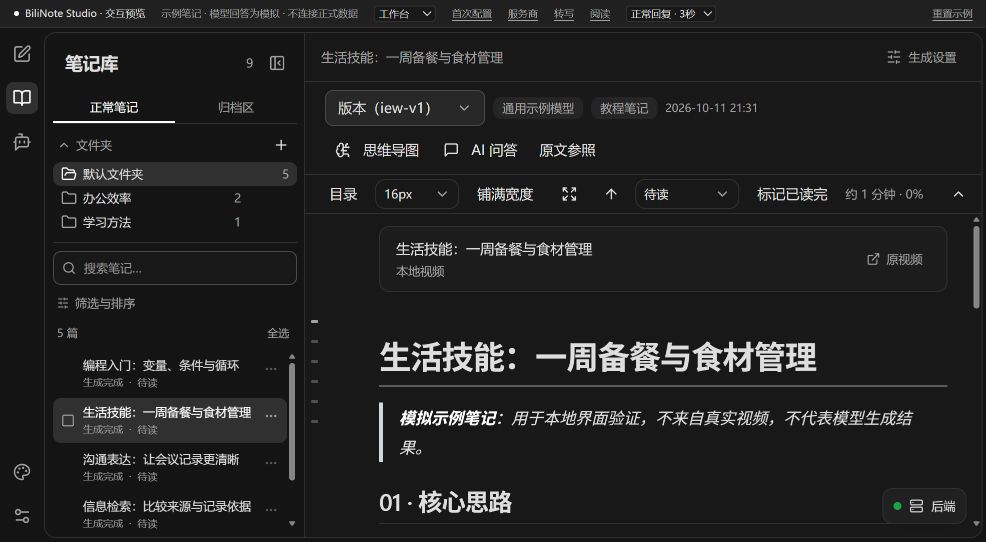
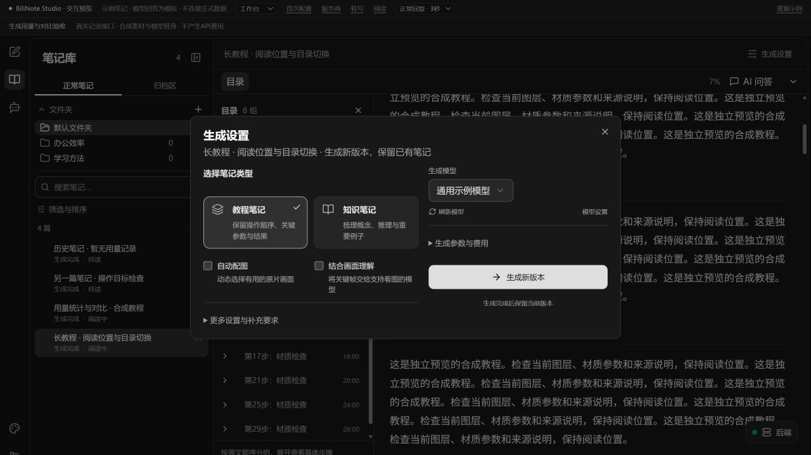
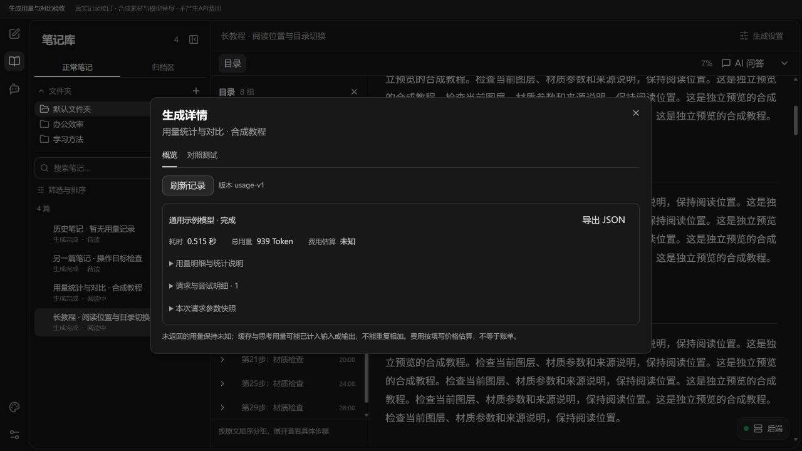
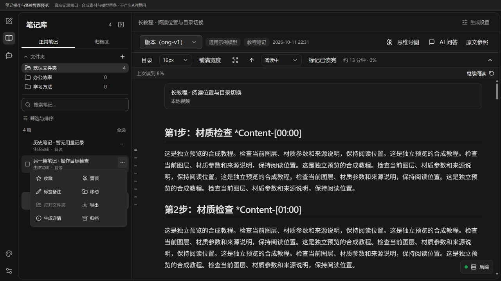

# BiliNote Studio

把视频教程变成可阅读、可提问、可整理的学习笔记。

BiliNote Studio 是基于 [JefferyHcool/BiliNote](https://github.com/JefferyHcool/BiliNote) v2.4.5 独立维护的非官方二次开发版本。它保留视频转写、总结、截图、思维导图与导出的基础流程，将重点延伸到生成后的知识管理和持续学习。

在一个工作区中组织笔记、记录学习进度、引用原文提问，再通过可审阅的计划整理笔记库。

> **版本状态（2026-10-12）**：[`0.1.0-preview.8` Windows x64预发行版已公开](https://github.com/hc568871650-commits/BiliNote-Studio/releases/tag/v0.1.0-preview.8)。源码、独立安装包、实际新安装与公开旧包升级均已核验；GitHub检查通过，公开附件已匿名下载比对。本次证据见[验证记录](docs/releases/0.1.0-preview.8-validation.md)。



本页截图来自 2026-10-12 的隔离预览，使用合成笔记与模拟模型，不包含个人教程或真实模型质量结论。累计变化见 [preview.8 发布说明](docs/releases/0.1.0-preview.8.md)。

## 本次累计更新

- **教程蒸馏与局部修订**：教程笔记和知识笔记、动态取帧、来源时间与配图对应，以及先预览、再采纳为新版本的局部重蒸馏。
- **生成过程与开销**：阶段与耗时、具体失败原因、用量和参数快照、费用估算、同一份来源的两方案对照。
- **模型与资料库问答**：按模型检测实际能力，阅读和资料库问答支持多种协议；资料库助手可检索正文、读取章节与转录，并提供来源。
- **阅读与桌面交互**：分组/全部目录、快捷目录与章节标记、紧凑笔记菜单、生成设置小窗；修复详情栏漏收起和切换笔记时正文横向弹动。

## 可以做什么

| 使用场景 | 主要能力 |
| --- | --- |
| 看教程、做笔记 | 视频来源与本地视频、两类笔记、动态取帧、时间戳、截图与 Markdown |
| 修订局部内容 | 根据原始字幕和可用画面重新蒸馏选段，预览后采纳为新版本 |
| 了解生成开销 | 请求与尝试明细、token/耗时、参数快照、费用估算和固定来源对照 |
| 管理学习资料 | 文件夹、标签、备注、搜索筛选、收藏置顶、批量操作与归档恢复 |
| 连续阅读 | 章节目录、阅读位置、继续阅读、字号与宽度设置、专注模式 |
| 围绕原文提问 | 选段引用、多段引用、阅读对话、临时聊天与图片或文本附件 |
| 查询与整理资料库 | 全库关键词检索与来源问答；修改资料时审阅计划、确认执行、查看结果与撤销 |
| 按用途选择模型 | 生成、阅读、整理分别配置默认模型，会话中临时切换 |
| 管理长对话 | 上下文用量提示、自动压缩与 `/compact` 手动压缩 |
| 调整工作环境 | 深浅主题、跟随系统、强调色、字体字号与动态效果 |

视频流程、基础问答与桌面能力来自上游；学习型笔记库、阅读工作台、引用聊天和计划式整理是本版的主要扩展。早期技术归属见[升级总览](CUSTOMIZATIONS.md)，本轮变化与验证范围见[累计发布说明](docs/releases/0.1.0-preview.8.md)。

## 从视频到学习笔记

新建页面集中设置视频来源、生成模型与笔记类型。教程笔记侧重操作顺序、对象、参数和检查结果；知识笔记侧重概念、因果、例子和适用条件。切换到阅读或设置时，未提交的生成草稿可以保留。

生成结果可结合 Markdown、时间戳、截图和思维导图使用；继续阅读时，可以从笔记回到对应的视频位置。

已有笔记的生成设置在小窗中打开，关闭后继续阅读。对需要修订的连续选段，可按原始字幕及可用画面局部重新蒸馏，查看修订稿与来源依据后再采纳，保留旧版本。



转写与总结需要自行配置相应服务。视频理解需要支持图片输入的模型；普通截图与视频理解是不同选项，不会因添加截图就自动发送视觉输入。

动态取帧结合画面变化、稳定状态和字幕提示寻找候选画面，改善固定间隔采样容易错过短暂操作的情况；它仍可能遗漏瞬时界面或小字，不等同于完整观看视频。原视频不可用时，局部重蒸馏可使用保留的原始字幕；没有原始字幕时不会仅凭旧笔记扩写。

## 了解生成进度与开销

生成页显示实际阶段、耗时及失败原因，成功或失败后停止计时。长视频按时间、字幕长度和请求大小分片；完整分片可作为恢复依据，截断正文不会被当作完整结果保存。

“生成详情”展示请求与实际尝试、token、耗时和参数快照。服务商未返回的数据保持未知，历史笔记不会补出不存在的统计。可配置输出上限、分片和重试预算，并按填写的价格估算费用；估算不等同服务商账单，缓存优化也不保证命中或节省比例。

对照测试可冻结同一份字幕与可用图片，比较两个模型或参数方案。结果独立保存，不覆盖原笔记；开始对照会产生新的模型请求。



## 让笔记库便于回顾

通过逻辑文件夹、标签、搜索与组合筛选查找资料。收藏和置顶保留常用内容，备注记录自己的学习线索，批量操作减少重复整理。

学习状态分为“待读、阅读中、已读完”。开始阅读后记录进度，完成学习由用户确认，重新打开笔记不会覆盖已完成状态。

阅读区提供分组/全部目录、标题搜索、快捷目录、章节标记、位置记忆、继续阅读、正文字号、阅读宽度与专注模式。目录从正文标题生成，避免在正文开头再占用一份超长目录。切换笔记或版本时首帧确定目录占位，手动展开、收起目录才播放宽度动画。

笔记侧栏和阅读工具可以收起。每篇笔记的“⋯”菜单集中提供收藏、置顶、标签备注、移动、导出、生成详情和归档等操作；桌面端可打开对应笔记目录。



思维导图支持主题同步、目录定位、节点折叠、拖动与缩放，便于在正文和结构概览之间切换。

## 引用原文，与阅读助手讨论

阅读助手与正文并排显示。选中文字或多个段落后加入引用，可围绕当前笔记解释概念、对比方法、提炼要点或提出复习问题。

引用保留来源和版本快照，便于核对回答所依据的内容。常驻对话保留阅读讨论，临时聊天处理短暂问题，也可以显式转入常驻对话。

- 一次选段操作中的多个段落合为一份引用，按原文顺序保存；每条消息最多 8 份引用或附件。
- 支持图片、TXT 与 Markdown 附件的选择、粘贴、拖入、预览和移除。
- 阅读与临时聊天默认流式回复，也可切换为完整回复。
- 输入区可以选择模型和适用的思考档位，并查看等待时间、回复用时与错误详情。
- 失败时保留或恢复问题和附件，便于修正后重试。

图片理解取决于所选模型，PDF 附件目前不支持。模型回答可能遗漏或误解内容，需要结合原文判断；取消本地等待不保证供应商已接收的请求停止计费。

## 查询资料库，审阅计划后整理

资料库助手可以按关键词查找本地笔记正文、读取相关章节与转录，并结合多篇笔记回答问题，提供可打开的笔记与版本来源。默认包含归档资料，也可用自然语言限定查询范围。

检索和读取有预算上限，相关内容会发送给所选模型。当前采用关键词与分块读取，不代表已对整个笔记库做语义向量检索或穷尽阅读。

整理助手把自然语言需求转化为具体计划：哪些笔记受影响、移到哪里、增加什么标签或进行哪些归档操作。

提出需求 → 审阅计划 → 点击确认执行 → 查看结果或撤销。

整理修改可以限定全部笔记、指定文件夹或选定笔记；只读查询范围不自动扩大写入权限。目标不明确时先澄清，修改需求会使旧计划的确认失效，聊天中输入“确认”不能代替计划按钮。

支持创建或重命名逻辑文件夹、移动笔记归属、调整标签、归档与恢复。整理助手没有永久删除笔记、改写正文或任意操作本地文件的权限。

整理会话保留历史计划与结果，可重新打开。撤销会检查后续变更，避免覆盖后来产生的冲突修改。

## 为不同用途选择模型

生成、阅读、整理可以使用不同服务商与默认模型，也可以共用同一模型。会话内的临时选择用于当前会话，不混淆不同服务商的同名模型。

阅读、资料库问答与整理计划可按服务商配置使用 OpenAI Chat Completions、OpenAI Responses 或 Anthropic Messages；视频总结目前仍走 Chat Completions 兼容接口。

模型设置提供基础回复、流式、工具、联网与候选思考档位的能力检测。主动检测会发送有界测试请求；已有记录可直接查看。参数被接受不等同于服务商内部采用了对应推理强度。

阅读问答的联网选项位于聊天设置中，默认关闭；可使用已验证的 Responses 原生搜索或配置的 SearXNG。当前资料库助手界面不启用联网搜索。

长对话提供用量提示和压缩入口。自动压缩或 `/compact` 使用所选模型生成摘要，保留原始聊天记录；整理计划和执行确认独立保存，不因压缩改变授权。

应用当前采用 272K 上下文预算，这不代表每个模型都支持该容量。本地 token 估算也不等同供应商的实际用量或计费。

## 适合长时间阅读的界面

提供深色、浅色与跟随系统模式，以及 8 种强调色。当前深色界面采用 Codex 风格的深灰配色，减少常驻装饰与工具栏占用。

界面字体、界面字号、代码字号与动态效果可以单独设置，笔记正文字号在阅读工具栏中调整。

## 开始使用

### Windows 安装

下载 [`0.1.0-preview.8` Windows x64预发行安装版](https://github.com/hc568871650-commits/BiliNote-Studio/releases/tag/v0.1.0-preview.8)及随附的 `SHA256SUMS.txt`，核对摘要后安装。安装包75,538,618字节，已完成实际新安装与公开preview.1升级验收、GitHub检查和匿名下载核验。

程序与笔记数据分开保存，数据位于 `%LOCALAPPDATA%\BiliNoteStudio`。使用独立目录，不覆盖原版 BiliNote，也不自动导入旧数据库。首次使用视频生成功能需另外安装 FFmpeg，并配置转写与模型服务；阅读已有资料不需要 FFmpeg。

当前安装版保留 Markdown 导出，不包含内置 PDF 导出、本地 Whisper 或抖音链接下载；仅提供单一安装版，不提供 Quick/Full 双版本或便携版。具体步骤见[用户指南](docs/studio/USER_GUIDE.md)。

### 先体验独立 UI 预览

已有源码且具备 Node.js 与 pnpm 环境时，可在仓库根目录执行：

```powershell
cd BillNote_frontend
pnpm install
pnpm dev:warm
```

随后打开 [本地 UI 预览](http://127.0.0.1:21483/ui-preview.html)。预览使用独立端口、浏览器存储、示例笔记和模拟 API，不启动桌面后端，不发起真实模型请求。

这适合体验布局、阅读、聊天和整理交互，不能用于实际视频生成，也不能验证自己的模型接口。端口被占用时会停止启动；先核查占用来源，不要停止已有正式服务。

### 运行真实流程

完整开发运行与打包请先阅读[源码同步与发行流程](RELEASING.md)。必须隔离前后端地址、应用标识、数据与缓存目录；普通源码启动与独立安装包使用不同配置，不能直接用开发默认值连接已有日常数据。

实际使用需要按用途配置模型、转写和视频下载服务。模型密钥、服务商费用及平台访问条件由使用者管理。

## 数据与旧版边界

Studio 的方向是独立安装、独立数据目录与新的笔记存储结构。后续不继续扩大旧版兼容范围，不采用新旧版本共享数据库或双向同步。

当前源码仍保留部分旧数据读取与迁移辅助代码；这不代表任意旧版数据库可以直接接入，也不构成通用无损升级承诺。安装版使用独立的 Studio 应用身份；旧数据迁移不在首发支持范围内。

笔记按任务组织正文、配图、版本与元数据。应用内的逻辑文件夹用于分类，移动分类不会移动或改写原始教程文件。

归档与永久删除分开：归档后可以阅读和恢复；手动永久删除仅面向符合条件的归档笔记，并限于其专属数据。整理助手不执行永久删除。

笔记存储在本机，但调用外部模型或转写服务时，相关内容会按所用功能发送给服务商。资料库问答会发送检索到的正文或转录；整理计划依据授权范围内的元数据生成。模型不会因此获得任意本地文件访问权。

真实使用前请备份重要数据；不要把密钥、Cookie、数据库、个人笔记或运行缓存提交到源码仓库。

## 当前限制

- 最新阅读协议、流式输出与不同网关的真实端到端兼容性仍需逐项验证，不能保证所有模型和平台都可用。
- 当前主要交付与验证围绕 Windows；通用干净环境、GPU 和本地模型组合尚未完成全面验收。
- 整理助手当前按单进程、单 worker 运行约束设计，不承诺多实例共享数据库的安全性。
- 全仓 TypeScript 仍有历史问题，专项构建与测试不等于所有类型检查通过。
- 动态取帧、局部重蒸馏和对照测试仍需结合原始来源判断质量；尚未完成真实长软件教程“生成后照做”的完整验收。
- 本次独立安装包已完成新安装及真实`preview.1`升级检查；新干净Windows虚拟机和首次WebView2联网安装仍未验证。当前证据见[preview.8 验证](docs/releases/0.1.0-preview.8-validation.md)，首发历史见[VALIDATION.md](VALIDATION.md)。

## 文档与上游

- [preview.8 发布说明](docs/releases/0.1.0-preview.8.md)：累计变化、验证范围和发行状态。
- [源码同步与发行流程](RELEASING.md)：Git 同步范围、版本检查和安装包发布步骤。
- [用户指南](docs/studio/USER_GUIDE.md)与[preview.8 验证记录](docs/releases/0.1.0-preview.8-validation.md)：当前安装与使用范围。[首发验证](VALIDATION.md)单独保留。
- [首发公告](docs/studio/RELEASE_ANNOUNCEMENT.md)：2026-10-08 的历史发布说明。
- [早期升级总览](CUSTOMIZATIONS.md)：上游归属与早期技术说明。
- [第三方许可与来源](THIRD_PARTY_NOTICES.md)：依赖归属与许可材料入口。
- [上游 BiliNote](https://github.com/JefferyHcool/BiliNote)：原项目介绍与使用资料。
- [变更记录](CHANGELOG.md)：Studio 发行更新及保留的上游历史。

## 许可证

本项目遵循 [MIT License](LICENSE)，保留 Jeffery Huang 的版权声明与上游许可证。感谢上游作者及贡献者。

BiliNote Studio 是独立维护的二次开发版本，并非上游官方发行。第三方依赖、模型服务与视频素材分别遵循其许可证、服务条款或使用授权。
