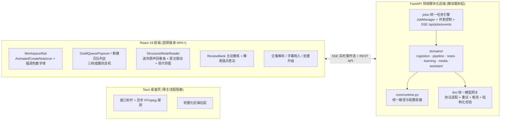

# BiliNote Studio 0.3.0 升级设计规范

- **编写日期**：2026-11-20
- **当前基线**：`0.2.0`（桌面 UI 精修已本地实装至 `E:\AI-Tools\BiliNote`，`local-release-0.2.0-ui-polish-20261119`）
- **目标版本**：`0.3.0`
- **关联实施计划**：[2026-11-20-studio-0.3.0-implementation-plan.md](./2026-11-20-studio-0.3.0-implementation-plan.md)

---

## 一、升级目标与已确认决策

本轮升级围绕**启动体验、现代后端底座、蒸馏过程可视化、单篇精读联动、主动复习闭环与课程级批量生产**六大主线展开。以下为用户已明确拍板的全部核心决策：

1. **启动极速优化（“又卡又慢”至少解决核心瓶颈，力争全链路提速）**：
   - 解决后端冷启动慢（重型库全面懒加载，端口毫秒级就绪）；
   - 解决前端首屏主线程卡顿（拆包瘦身，将首屏同步 JS 从 >3.2 MB 压降 60%+，移除首屏阻断白屏）；
   - 解决 Tauri 壳 `setup` 主线程同步阻塞（`check_ffmpeg_availability` 移入后台线程）。
2. **后端重构路线（方案 1：兼容老数据的领域模块化重构）**：
   - **100% 兼容现有用户数据**（`bili_note.db`、`note_results`、`records-v2`、DPAPI 凭据、Organizer 会话与撤销契约），不做破坏性数据迁移；
   - 建立统一运行时配置/路径容器、统一任务队列与 SSE 事件流、统一模型网关，并按清晰业务域拆分臃肿模块。
3. **统一蒸馏队列 + 动态新建图标 + 三档提醒**：
   - **书架与生产车间彻底分离**：正在生成/排队的任务收拢到统一蒸馏队列，不再散落污染正式笔记列表；成品笔记若正在后台重新生成或结构化升级，仅在列表条目旁保留极轻动态微点；
   - **导轨「新建笔记」图标升级**：蒸馏队列存在活跃任务时，图标本身展示克制流畅的动态书写微动效，右下角显示**动态强调色小球徽章**（内含活跃队列数字）；
   - **三档完成提醒策略**：支持「**蒸馏完所有再提醒**（默认）」「**每一篇都提醒**」「**不提醒**」，支持队列顶部快捷切换与「设置 → 通用」持久化，应用冷启动绝不误报历史笔记。
4. **方向 A：单篇精读联动与原声回看**：
   - 接入后端已有 Range `/media/` 流式接口，落地 Liquid Glass 迷你原声回看条（点击时间戳应用内秒跳播放）；
   - 点击时间戳/批注/错题联动滚动并高亮「原文参照」对应片段，原文参照面板支持拖拽调宽；
   - 思维导图直接对接结构化笔记并统一到 Apple HIG × Codex 视觉语言。
5. **方向 B：主动复习闭环与知识外带**：
   - 错题与高频避坑弹窗升级为可**原位重练 + 标记「已掌握」移出**的主动复习闭环；
   - 从复习本或全文搜索跳入笔记时，精准滚动到目标章节/题卡并短暂强调色脉冲高亮；
   - 导出新增 **Anki 闪卡（`.tsv` / 兼容格式）** 与 **Obsidian 增强双链/Callout 格式**。
6. **方向 D：课程级批量与多源导入**：
   - 基于统一队列引擎支持 **B 站多 P 合集 / 播放列表解析与勾选批量入队**（自动归入同名文件夹、失败单项重试）；
   - 支持**本地音视频与字幕（`.srt` / `.vtt`）直接拖入生成**（纯字幕跳过下载转写直出结构化笔记）；
   - 支持**旧版 Markdown 笔记一键批量结构化升级**。

---

## 二、总体架构设计

---

## 三、分模块详细设计

### 3.1 启动极速优化（全链路）

| 层次 | 现状实测瓶颈 | 0.3.0 改造方案 | 验收目标 |
| --- | --- | --- | --- |
| **后端冷启动** | `app/__init__.py` 启动即同步导入全部 12 路由，连带加载 `yt_dlp`、`chromadb`、`langgraph`、`langchain`、`faster_whisper`、`openai`、`cv2/PIL` | 顶层路由仅导入轻量 Pydantic 模型与薄分发器；所有重型依赖下沉到函数/服务首次执行时懒加载（`lazy_import`），`lifespan` 仅做轻量 SQLite/事件注册，非关键清理移入异步后台任务 | 隔离环境冷启动至 `/api/sys_health` 200 耗时显著下降（目标压降 ≥ 50%，纯源码态 < 1.5s） |
| **前端首屏包体** | 同步加载 `index.js`（1.54 MB）+ `markdown.js`（1.03 MB，含全量 Prism 语言包）+ `markmap.js`（669 KB）≈ 3.24 MB | 1. `MarkmapEditor`（含 `markmap-view`/`markmap-toolbar`/`JSZip`）改为 `React.lazy`； 2. 代码高亮从全量 `Prism` 改为按需语言 `PrismLight` + 懒加载； 3. `ReviewBankDialog`、`NoteExportDialog`、`RefineNoteDialog`、`GenerationDetailsDialog` 全部按需拆包； 4. 启动等待态改为轻量骨架外壳，不再用重型阻断弹窗锁死主窗口 | 首屏同步 JS 体积下降 ≥ 55%，`pnpm.cmd build` 无单 chunk > 1 MB（核心业务 chunk） |
| **Tauri 壳** | `lib.rs` `setup` 主线程同步调用 `check_ffmpeg_availability()` | 将 FFmpeg 检测移至独立后台线程执行，结果按需缓存/通知前端；窗口创建与后端拉起零阻塞并行 | 桌面窗口首帧无子进程同步等待 |

### 3.2 方案 1 后端领域模块化重构（兼容老数据）

1. **统一运行时容器（`backend/app/core/runtime.py`）**：
   - 收口 `DATA_DIR`、`NOTE_OUTPUT_DIR`、`UPLOAD_DIR`、`SCREENSHOT_DIR`、`DB_PATH`、`API_BASE_URL` 等路径与环境读取；
   - 彻底消除模块 `import` 时的 `os.makedirs` / `load_dotenv` 副作用，所有测试可通过注入 `RuntimeConfig` 一步隔离。
2. **统一任务队列与实时事件引擎（`backend/app/jobs/`）**：
   - 数据模型 `JobRecord`：`job_id`、`task_id`、`kind`（`generate` / `regenerate` / `upgrade_structured` / `batch_item`）、`batch_id`（可选）、`title`、`status`（`QUEUED` / `DOWNLOADING` / `TRANSCRIBING` / `SUMMARIZING` / `SAVING` / `SUCCESS` / `FAILED` / `CANCELLED`）、`progress`、`stage_message`、`model_name`、`created_at`、`started_at`、`finished_at`、`error_summary`；
   - `JobManager`：内置可配置并发度（默认生成并发 `2`，下载/转写合理限流）、有序排队、协作式取消令牌（`CancellationToken`）、失败单项重试、启动期恢复中断任务为可重试态；
   - **SSE 事件流**：新增 `GET /api/jobs/events`（断线自动重连，支持首包 `snapshot` 全量同步当前活跃与最近完成任务 + 增量 `job.updated` / `job.completed` / `job.failed` / `queue.drained` 事件），同时保留 `GET /api/jobs` 快照接口与原有 `/api/task_status/{task_id}` 兼容路由；
   - 任务队列记录持久化到 `data/jobs_state.json` 或 SQLite 独立表（仅存近期活跃与最近 50 条终态记录，不影响 `bili_note.db` 既有表结构）。
3. **统一模型网关（`backend/app/llm/`）**：
   - 整合 `universal_gpt.py`、`ai_client.py`、`gemini_client.py`、`protocol_clients.py` 中的重复重试、超时、取消检查、流式解析、用量归集与结构化 JSON 容错修复；
   - 保留原有调用入口薄包装以通过全部历史单测，新逻辑统一走 `LLMGateway`。
4. **清晰业务域拆分（`backend/app/domains/`）**：
   - `ingestion/`：视频平台解析、B 站多 P 合集/播放列表解析、本地音视频与 `.srt/.vtt` 字幕导入；
   - `pipeline/`：可插拔四阶段管线（`AcquireMedia → Transcribe → SynthesizeNote → PersistNote`），与 `NoteGenerator` 解耦；
   - `notes/`：对 `note_storage.py` 做职责拆分（版本读写、元数据索引、维护回退），100% 保持 `records-v2` 格式不变；
   - `learning/`：独立路由 `/api/learning/*`，扩展错题掌握状态（`mastered` / `review_count` / `last_reviewed_at`）、原位重练提交与精准锚点信息（`section_id` / `quiz_id` / `annotation_id`）；
   - `media/`：独立路由 `/api/media/*`，承接 Range 媒体流与时间戳到转写段索引映射；
   - `assistant/`：保持 `organizer.py` / `organizer_sessions.py` / `chat_service.py` 现有契约与测试不变，仅改为懒加载重型依赖（`langgraph` / `chromadb`）并接入统一 `LLMGateway`。
   - 注：历史遗留拼写错误目录 `app/enmus/` 通过新模块 `app/enums/` 承接并保留旧路径兼容导出（re-export），避免破坏任何既有测试与插件导入。

### 3.3 统一蒸馏队列 UI + 动态新建图标 + 三档提醒

1. **导轨动态图标与强调色数字球**：
   - 新增 `AnimatedCreateNoteIcon`（位于 `BillNote_frontend/src/components/AnimatedRailIcons.tsx`，`17px`、`strokeWidth=1.65` 与现有 `AnimatedNotebookIcon` / `BackendEngineIcon` 保持统一工艺）；
   - `activeCount > 0` 时启动笔尖轻缓书写微动效（纯 GPU `transform`，遵循 `prefers-reduced-motion` 与 `html[data-reduced-motion="true"]`）；
   - 右下角徽章使用 `var(--reading-accent)` 动态强调色 + 细底色描边防粘连，个位数为正圆、两位数平滑扩展为微胶囊（上限 `99+`），数量变化触发 `--ease-spring` 弹簧缩放。
2. **统一队列交互（书架与生产队列分离）**：
   - **前端 Store**：`distillQueueStore` 订阅 `SSE /api/jobs/events`（若运行于离线预览 mock 环境则平滑降级到 mock 队列流），实时维护 `activeJobs`、`recentFinishedJobs`、`activeCount`；
   - **在阅读 / 助手 / 设置页**：悬停或右键/触发队列按钮可展开 Apple HIG 高透毛玻璃「蒸馏队列」浮层（`--glass-bg` + `--glass-blur` + `--ease-spring`），实时显示阶段进度条、耗时、模型，支持一键取消、失败重试、查看诊断、清空已完成、点击已完成项直达阅读；
   - **在新建笔记页**：页面顶部/侧栏集成紧凑蒸馏队列卡片区，支持边看队列进度边继续贴链接或批量提交；
   - **笔记列表保持纯粹**：书架默认仅展示已有可读内容的成品笔记；若某篇成品笔记正在后台「重新生成」或「结构化升级」，仅在条目旁展示极轻的动态指示微点。
3. **完成提醒三档设置与状态机**：
   - 持久化偏好：`distillNotificationMode: 'all_done' | 'each' | 'off'`，**默认值 `'all_done'`（蒸馏完所有再提醒）**；
   - 双入口同步：位于「设置 → 通用」以及蒸馏队列浮层头部极简三段切换控件；
   - **状态机防误报规则**：
     - 应用初始化首包 `snapshot` 仅记录初始活跃任务集合，绝不对历史已终态任务弹窗；
     - `'each'`：每个被追踪的活跃任务进入终态（`SUCCESS` / `FAILED`）时立即弹出毛玻璃轻提醒卡（成功带「打开阅读」，失败带「查看诊断」）；
     - `'all_done'`：维护当前活跃批次计数（`succeeded` / `failed` / `lastSucceededTaskId`），仅当活跃队列由 `>0` 归零至 `0` 时合并弹出一条汇总提醒，随后清空批次计数；
     - `'off'`：完全静默；
     - 若桌面窗口处于失焦/后台状态（`document.hidden`），`'each'` 与 `'all_done'` 同步尝试发送系统级桌面通知（无权限时静默回退到应用内提醒）。

### 3.4 方向 A：精读联动 + 原声回看 + 现代思维导图

1. **Liquid Glass 迷你原声回看条（`MiniMediaPlayer`）**：
   - 阅读器检测当前笔记是否具备可用本地媒体流（`GET /api/notes/{task_id}/media` 或 `/api/media/{task_id}` HEAD/元信息探测）；
   - 点击正文/结构化笔记中的任意时间戳胶囊时：
     - 若本地媒体存在：底部居中浮出高透毛玻璃迷你回看条（零排版挤压），自动 `seek` 至目标秒数并播放，支持播放/暂停、±5s 快退快进、倍速切换（`0.75x / 1x / 1.25x / 1.5x / 2x`）、音量与关闭；
     - 若无本地媒体：保持现有跳转原视频链接行为（B 站/YouTube 带 `?t=`）。
2. **三向联动定位 & 原文参照拖拽调宽**：
   - 「原文参照」面板采用与 `ReadingChatLayout` 一致的拖拽分隔把手（`min/max` 宽度限制 + `localStorage` 记忆宽度）；
   - 点击结构化笔记时间戳 / 批注 / 迷你播放器播放进度变化时，可在原文参照面板自动滚动并柔和强调色高亮对应转写段；点击原文转写段也可反跳播放对应时间点。
3. **现代思维导图对接结构化笔记**：
   - 思维导图优先读取 `StructuredNoteDocument`（章节 → 核心结论 / 因果链 / 避坑要点，复用并增强 `structuredNoteToMindmapMarkdown`），无结构化数据时回退 Markdown；
   - 移除早期彩色系统 Emoji 与粗框原生表格样式，工具栏与配色统一接入 `--reading-accent` / `--glass-*` / `--surface-*` Token，支持深浅模式自适应；
   - 整个 `MarkmapComponent` 异步懒加载，彻底退出首屏主包。

### 3.5 方向 B：主动复习闭环 + 精准锚点直达 + 多格式导出

1. **主动复习闭环（`ReviewBankDialog` 升级）**：
   - 后端 `learning` 域补充字段与接口：
     - `POST /api/learning/review-bank/practice`：提交错题重练结果（答对可选自动标记已掌握、或手动切换掌握状态 `mastered: boolean`）；
     - `POST /api/learning/review-bank/pit-status`：标记某条高频避坑为「已掌握 / 需再复习」；
     - 复习库列表支持筛选「待复习（默认）」/「已掌握」，显示每项对应的 `section_id`、`quiz_id` / `annotation_id` 与章节名。
   - 前端交互：
     - 在复习弹窗内支持直接展开**原位重练卡片**（复刻结构化阅读器三级判题视觉层次，或翻卡自检高频避坑），答对后一键「标为已掌握」平滑移出待复习池；
     - 保留「去原笔记定位」按钮。
2. **精准锚点直达（跨路由锚定）**：
   - 扩展前端导航上下文（`sourceNavigationStore`）支持 `sectionId`、`quizId`、`annotationId`、`highlightQuery`；
   - 从复习本或全文搜索点进笔记后，等结构化阅读器/Markdown 渲染完成自动平滑滚动至对应元素，若为自测题/批注可自动展开或给予 1.6s 动态强调色柔光脉冲提示。
3. **知识外带格式增强（`NoteExportDialog`）**：
   - 在现有「增强 Markdown」「单文件交互 HTML」基础上，新增：
     - **Obsidian 增强 Markdown（`.md`）**：含 YAML Frontmatter（来源链接、标签、生成时间、模型）、Obsidian Callout（`> [!tip]` / `> [!warning]` / `> [!question]`）与时间戳双链/锚点；
     - **Anki 闪卡导出（`.tsv`）**：自动从结构化笔记的自测题（题干 + 选项 → 正确答案 + 解析）与高频避坑批注（标题/原句 → 避坑详解）生成标准制表符分隔导入文件（UTF-8 BOM 兼容中文），并显示导出卡片数量预览。

### 3.6 方向 D：课程级批量导入与多源生产

1. **多 P 合集 / 播放列表解析与批量入队**：
   - 新增后端接口 `POST /api/ingestion/resolve-collection`：给定 B 站多 P / 合集 / YouTube Playlist 链接，通过懒加载的解析器返回合集标题与分 P 列表（编号、标题、时长、是否已生成去重标识）；
   - 前端新建页自动识别合集链接后呈现简洁的勾选清单（默认全选或按需勾选），可选「自动创建并归入同名文件夹」，一键提交全部进入 `jobs/` 统一队列依次执行；单条失败可在队列中单独重试。
2. **本地音视频 & 字幕（`.srt` / `.vtt`）拖入直出**：
   - 新建页上传区支持拖拽 `.mp4 / .mkv / .mp3 / .m4a / .wav` 与 `.srt / .vtt`；
   - 上传 `.srt` / `.vtt` 时，后端 `ingestion/subtitle_parser.py` 直接解析为标准 `TranscriptResult`（保留时间戳分段），**跳过下载与 Whisper 转写阶段**，直接进入结构化笔记蒸馏管线。
3. **旧版 Markdown 笔记批量结构化升级**：
   - 在笔记列表多选工具栏（及设置/复习入口）提供「批量升级为结构化笔记」动作；
   - 仅筛选尚未具备结构化版本的选中笔记，弹出清晰费用/模型确认提示（遵循 `AGENTS.md` 涉及费用必确认红线），确认后逐篇推入统一蒸馏队列并纳入角标计数与 `all_done` 提醒。

---

## 四、不可违背的红线与设计约束

1. **正式版绝对保护**：开发与测试全程隔离端口、API 地址、数据与缓存目录，未经用户再次明确授权，绝不触碰 `E:\AI-Tools\BiliNote`（端口 `8483`）及外部受保护目录。
2. **老数据 100% 兼容**：`bili_note.db`、`note_results`（`records-v2`）、DPAPI 加密密钥、Organizer 会话与撤销契约不可破坏。
3. **UI/UX 工艺红线**：严格遵守 `.agent/rules/bilinote-ui-guide.md`：
   - 高透毛玻璃配方（严禁不透明实心块硬遮挡），`.quiz-anchor-slot` 不设 `z-index`，`.morph-quiz` 不设 `will-change: width, height`；
   - 动态强调色派生，无硬编码固定色；
   - Apple 弹簧曲线 `--ease-spring` 与完整减动效守卫；
   - 界面默认少文字，涉及费用/不可逆操作必须有明确提示与确认。
4. **验证纪律**：每阶段完成须跑对应前后端单元测试、`npx.cmd tsc --noEmit`、`pnpm.cmd build`、并在隔离预览或隔离真实流程完成验证；不以 mock 宣称真实模型流程通过。
