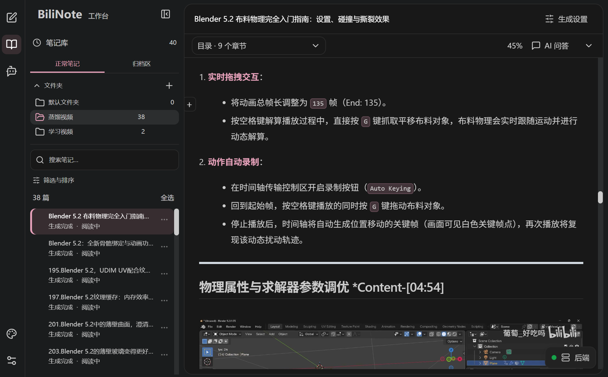
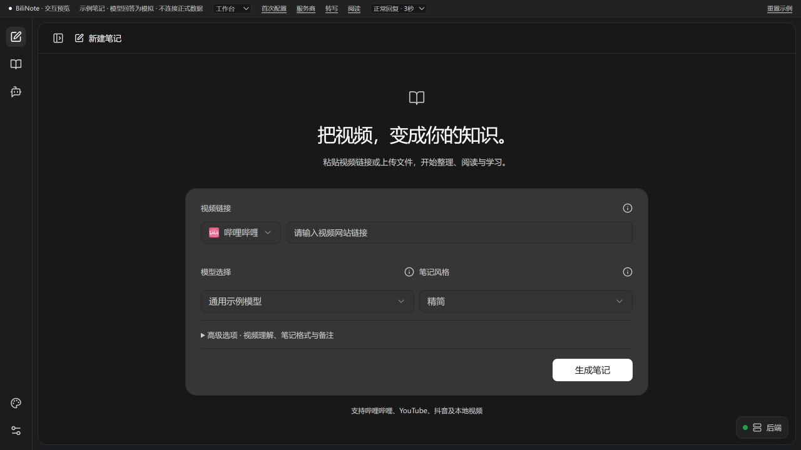
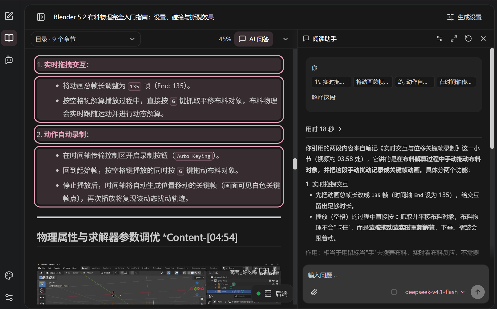
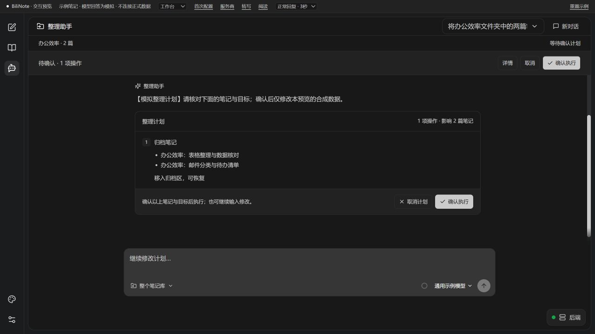
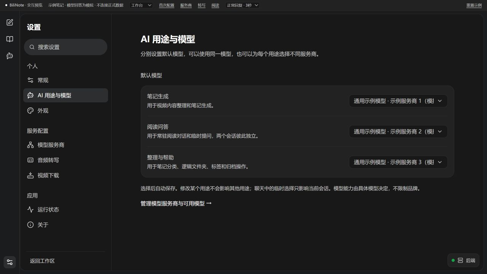
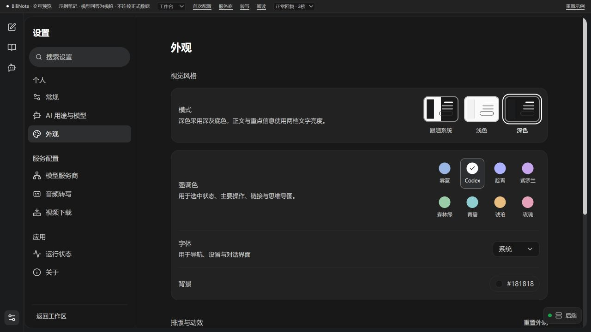

# BiliNote Studio：从视频笔记到学习工作台

**把视频教程变成可阅读、可提问、可整理的学习笔记。**

BiliNote Studio 是基于 [JefferyHcool/BiliNote](https://github.com/JefferyHcool/BiliNote) v2.4.5 独立维护的二次开发版本。在原有视频转写、模型总结、截图、思维导图和导出的基础上，进一步完善笔记管理、阅读体验、引用式问答与 AI 整理流程。

我们的目标是让生成的笔记能够被持续使用：找到需要的资料，回到上次读到的位置，围绕原文提问，再把积累的内容整理成自己的学习库。

> **版本**：`0.1.0-preview.1`，首个公开预览版。单一 Windows x64 安装版；基于上游 v2.4.5 独立维护。

*工作台总览与下方阅读助手图由维护者提供，展示实际使用界面；其余图片来自隔离预览，使用示例笔记和模拟回答。截图来自首发前开发阶段，展示交互与布局；实际功能以首发范围为准，不作为模型回答准确性的保证。*

## 这次扩展了什么

| 方向 | 主要变化 |
| --- | --- |
| 笔记管理 | 逻辑文件夹、标签备注、收藏置顶、搜索筛选、批量操作、归档与恢复 |
| 持续阅读 | 章节目录、阅读进度与位置记忆、继续阅读、专注模式、字号与宽度设置 |
| 阅读问答 | 选段和多段引用、常驻与临时聊天、图片和文本附件、流式回复 |
| AI 整理 | 限定范围、讨论与澄清、审阅计划、确认执行、结果追踪与撤销 |
| 模型配置 | 生成、阅读、整理分别选择模型；阅读支持三种协议 |
| 长对话 | 上下文用量提示、自动压缩和 `/compact`，保留原始聊天记录 |
| 桌面体验 | 深浅主题、强调色、紧凑布局、新版启动页、后端状态与单实例唤回 |
| 稳定性 | 长音频分段、空转录缓存修复、截图按需提取、长时间标记与错误反馈 |

视频生成、基础问答和桌面运行能力继承自上游；Studio的主要工作是扩展学习型笔记库、阅读工作台、引用聊天、计划式整理，并改善相关交互与可靠性。

## 1. 视频生成与阅读各有自己的空间

新建笔记时，视频来源、模型与笔记风格集中在主区域；视频理解、笔记格式和备注放在高级选项中。切换页面时保留未提交的草稿，阅读时可以收起侧栏与工具栏，把空间交还给正文。

普通截图与视频理解分开处理：选择截图不会自动把大量视频画面发送给模型，视觉理解需要显式开启并选用支持图片输入的模型。

## 2. 把笔记变成可以回顾的学习资料

文件夹、标签、搜索和组合筛选用于查找资料；收藏与置顶突出常用笔记，备注记录自己的理解，批量操作减少重复整理。

学习状态分为“待读、阅读中、已读完”，完成阅读由用户确认。章节导航、阅读位置记忆和继续阅读帮助接续学习；思维导图提供结构概览、目录定位、拖动和缩放。

每篇笔记按任务保存正文、图片、版本与元数据。应用内文件夹是逻辑分类，移动分类不会搬动或改写原始教程文件。

## 3. 引用原文，边读边问

阅读助手与笔记并排显示。选择一段或多段原文加入引用，就可以围绕其中的概念、操作或疑问继续讨论。引用保留来源和版本快照，便于回到原文核对。

- 常驻对话保存阅读讨论；临时聊天处理短暂问题，也可显式转入常驻对话。
- 支持图片、TXT、Markdown附件的选择、粘贴、拖入、预览与移除。
- 默认流式回复，可停止等待；已接收内容保留并标注中断。
- 模型与适用的思考档位在输入区选择，等待用时、回复耗时和错误详情可查看。
- 空回复与请求失败有明确反馈，并保留或恢复问题、引用和附件。

PDF附件目前不支持。图片理解和回答质量取决于所选模型；停止本地等待不保证供应商已经接收的请求停止处理或计费。

## 4. 整理前先看计划

整理助手支持自然语言提出需求，再把操作变成可以核对的计划：影响哪些笔记、目标文件夹是什么、需要添加什么标签或进行哪些归档操作。

**提出需求 → 审阅计划 → 点击确认执行 → 查看结果或撤销。**

可以限定笔记范围。目标含糊时先澄清，修改需求会使旧审批失效，聊天里输入“确认”不会替代计划按钮。

整理助手可创建和重命名逻辑文件夹、移动归属、调整标签、归档与恢复；不具备永久删除笔记、改写正文或任意操作本地文件的能力。历史会话保留计划与结果，撤销时检查冲突，避免覆盖后续修改。

## 5. 按用途配置模型，管理长对话

笔记生成、阅读问答、整理助手可分别设置默认服务商与模型，也可共用一套连接。会话中的临时选择只作用于当前会话。

阅读聊天支持 **OpenAI Chat Completions、OpenAI Responses、Anthropic Messages**。视频总结仍使用Chat Completions路径；这些阅读协议选项不代表整理流程已经切换为相同协议。

长对话提供用量提示、自动压缩和 `/compact` 手动压缩。压缩使用所选模型生成摘要，保留原始记录，且不改变整理计划的审批状态。当前应用预算为272K，实际模型容量与计费仍由服务商决定，本地估算不等于账单用量。

## 6. 统一外观与启动体验

提供深色、浅色、跟随系统和8种强调色；界面字体、字号、代码字号和动态效果可以调整。当前深色界面采用Codex风格的深灰底色，常规文字与重点交互使用两档亮度。

启动等待、失败和首次配置页统一样式；减少不必要装饰，保留明确的状态、重新检查和日志入口。启动前段提高就绪检测频率，同时保留超时与业务健康检查，不承诺固定的整体启动提速比例。

## 数据与安装方式

Studio按**独立安装、独立数据目录和新的笔记存储结构**准备，不建议直接覆盖原版安装目录。

现阶段不继续扩大旧版兼容范围，不做新旧版本共享数据库或双向同步，也不提供通用无损迁移承诺。当前源码仍保留部分旧数据读取和迁移辅助代码，并未在本次整理中删除；未来如有实际需要，再独立评估转换工具。

笔记在本机保存；使用外部模型或在线转写时，相关内容会发送给所选服务商。整理工具上下文限定为允许的笔记元数据。实际使用需自行配置模型、转写及平台访问条件，重要资料建议保留备份。

安装程序与校验文件见 [Releases](https://github.com/hc568871650-commits/BiliNote-Studio/releases)，步骤见[用户指南](USER_GUIDE.md)。首发不发布便携版，不内置 FFmpeg 或 PDF 导出。

## 已有验证与当前限制

- 已有前端与桌面构建、专项回归、隔离预览和本地安装验证；最新本地部署进行了笔记与配置保护核验。
- 历史上完成过指定长视频的实际转写、总结及截图生成，但不代表全部平台、模型和网关都已经验证。
- 最新阅读三协议与流式输出主要有隔离传输测试；不同实际服务商仍需逐项验证。
- 当前验证主要围绕Windows，通用干净环境、GPU及本地模型组合尚未全面验收。
- 整理助手按单进程、单worker约束设计；全仓TypeScript仍有历史问题。
- 本版的实际验证与未覆盖环境见 [VALIDATION.md](../../VALIDATION.md)。

## 上游与许可证

感谢 [JefferyHcool/BiliNote](https://github.com/JefferyHcool/BiliNote) 作者 Jeffery Huang 及上游贡献者。BiliNote Studio是独立维护的二次开发版本，并非上游官方发行；保留上游 [MIT许可证及版权声明](../../LICENSE)。第三方依赖、服务与视频素材分别遵循其自身的许可或使用条件。

进一步了解：[项目首页](../../README.md) · [完整升级总览](../../CUSTOMIZATIONS.md) · [开发入口](../../DEVELOPMENT.md)

## 首发功能范围

本次安装版仅提供在线转写（Groq、剪映、快手），不内置本地 Whisper；暂不提供抖音链接下载，可导入已下载的本地视频。笔记管理、阅读问答、整理助手与 Markdown 导出保留。FFmpeg 需另外安装，PDF 导出不内置。
